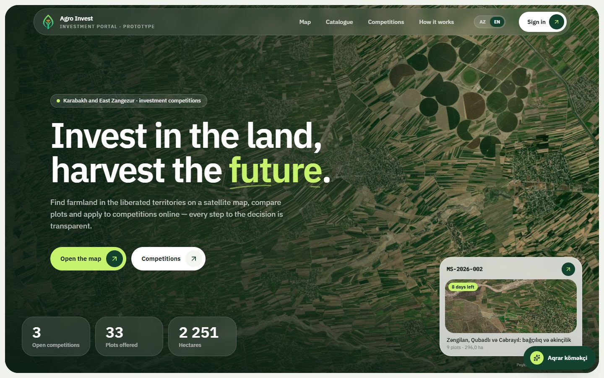
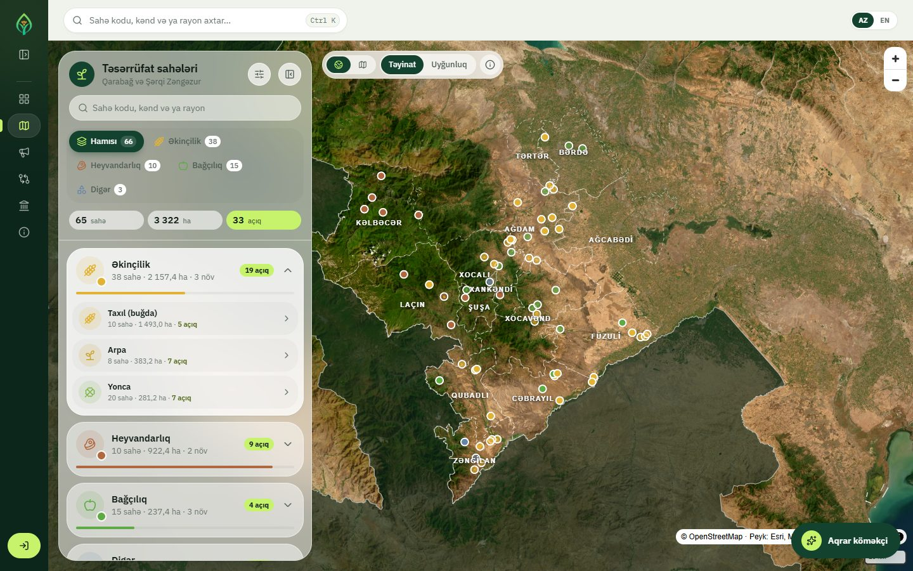
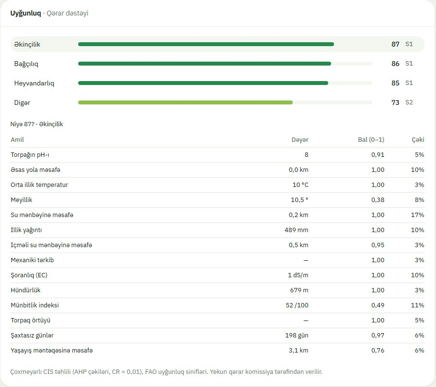
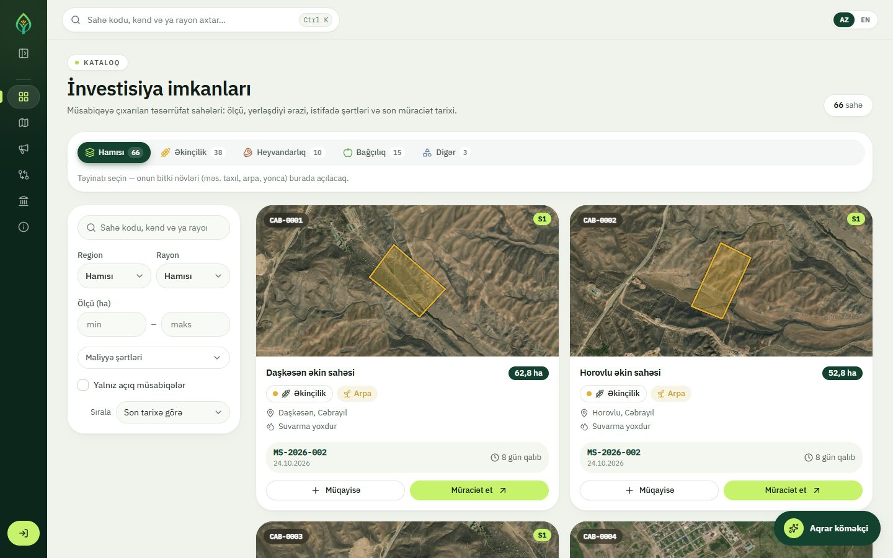
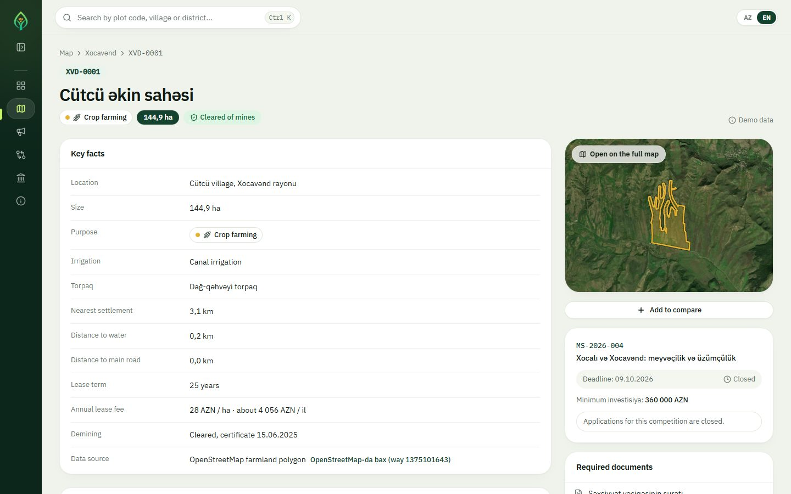
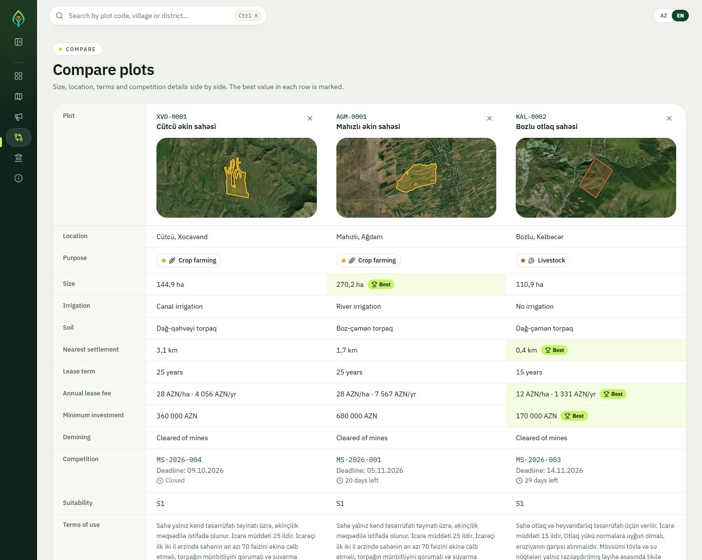
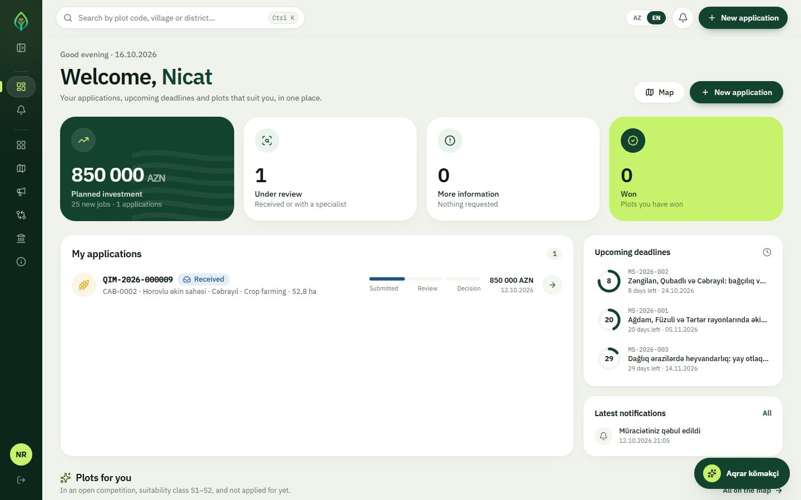
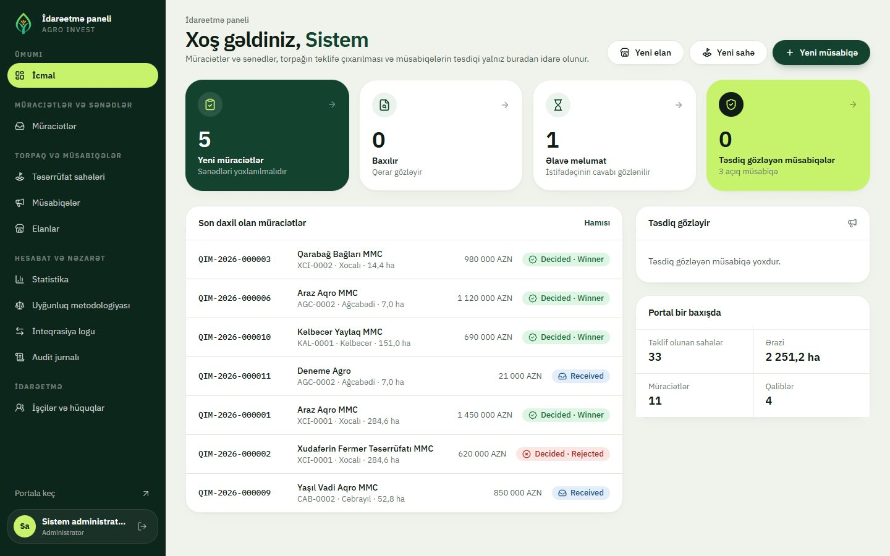
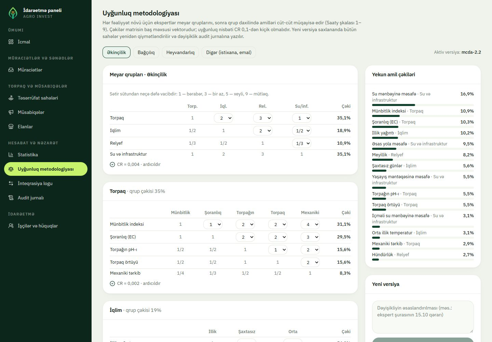

<div align="center">

# Agro Invest

**Investment competition portal for agricultural land in Azerbaijan's liberated territories**

Karabakh and East Zangezur · interactive satellite map · GIS land-suitability analysis ·
electronic application · administration console · EKTİS-ready integration

🏆 **1st place — Agro Hackathon 2026**, team **FARAD**

[**Live portal**](https://farad-agro-web-ay30.onrender.com) ·
[Map](https://farad-agro-web-ay30.onrender.com/map) ·
[Catalogue](https://farad-agro-web-ay30.onrender.com/catalogue) ·
[API docs](https://farad-agro-api-o8bw.onrender.com/api/v1/docs) ·
[Methodology](docs/suitability.md) ·
[Data sources](docs/data-sources.md)



</div>

Agricultural land in the liberated territories is leased to entrepreneurs through investment
competitions (Presidential Decree No. 236, 2024). Agro Invest puts the whole process in one
place: investors find plots on a satellite map, see **why** a plot suits an activity, compare
plots, apply online and follow every step of their application; the Ministry's staff prepare
plots and competitions, review applications with a full audit trail and hand decisions to
**EKTİS**, the Ministry of Agriculture's information system (a mock of its interface is
included; the real system is never contacted).

> Prototype: competition terms, applicants and demining data are demo data. Plot polygons,
> villages, roads and water come from OpenStreetMap — see [data sources](docs/data-sources.md).

## Highlights

### Satellite map of every plot

61 farm areas across 14 rayons, coloured by purpose and grouped by crop type, on satellite
imagery with Azerbaijani place names only. Filters by purpose, region, size, lease fee and
minimum investment; an offline basemap served from our own database when there is no internet.



### Land suitability you can explain

Each plot is scored for crops, orchards, livestock and other uses with a GIS multi-criteria
analysis: 18 soil, climate, terrain and access factors, two-level **AHP** weights (consistency
ratio < 0.1), **FAO** classes S1–N and hard constraints such as demining. "Niyə 87?" breaks
every score down by criteria group and factor, with each factor's contribution and a "nümayiş"
tag on values that are still synthetic; experts edit the AHP matrices in the console and every
new method version re-scores all plots. Details: [methodology](docs/suitability.md); which
inputs are real today: [data sources](docs/data-sources.md).

<p align="center"></p>

### Investment catalogue and plot pages

Satellite thumbnails, terms of use, deadlines and the competition each plot belongs to; side-by-
side comparison of up to four plots with a transparent **TOPSIS** ranking. Every plot traced from OpenStreetMap links
to its original polygon.







### Investor cabinet

Planned investment, applications and their status, upcoming deadlines, notifications and plots
that match the investor's budget and interests.



### Administration console

The Ministry's side: what waits for review, the latest applications and the portal in figures;
staff see only the sections their permissions allow. The methodology editor lets experts change
the AHP comparisons with live weights and consistency ratio.





### And more

- **Electronic application** — Azerbaijani citizens (FİN), foreign citizens (passport) and
  companies (VÖEN); business plan, documents, application number and printable receipt.
- **Application tracking** — statuses, reasons, history and notifications.
- **Administration console** — overview of pending work, review queue with masked identifiers,
  competitions with four-eyes approval, listing desk with plots drawn on the map, staff accounts
  with positions and fine-grained permissions, statistics and Excel reports.
- **Aqrar köməkçi** — an AI assistant that works only through the portal's own data: it searches
  the catalogue, explains plots, compares them, lists competitions and statistics, and follows a
  signed-in user's applications. Questions can be typed or dictated.
- **Azerbaijani and English** — the whole portal and the administration console switch language
  with one toggle.
- **EKTİS integration** — transactional outbox, automatic retries, signed (HMAC) callbacks and an
  integration log; hash-chained, tamper-evident audit log.

## Architecture

| Layer | Technology |
|---|---|
| Web | Next.js 15, React 19, TypeScript, Tailwind CSS, MapLibre GL |
| API | Python 3.12, FastAPI, SQLAlchemy 2 (async), Alembic |
| Data | PostgreSQL with PostGIS (Neon for the hosted demo); OpenStreetMap via an offline GeoPandas pipeline |
| EKTİS mock | Java 21, Spring Boot 3 (contract-first OpenAPI) |
| Delivery | Docker Compose with an nginx gateway; Render Blueprint for the hosted demo |

## Live demo

The hosted demo runs on Render's free plan and is kept awake 13:00–01:00 (Baku); outside those
hours the first page can take up to a minute to open. Sign in as the demo portal user
`investor@agro-demo.test` (password `Demo2026!`) or register at `/register`. Staff and
administrator accounts of the hosted demo have their own passwords and are not published.

## Run it

Requirements: Docker Desktop (Windows/macOS) or Docker Engine with Compose v2, about 6 GB of
free RAM. No other tools are needed. After the first build everything works offline.

```powershell
./scripts/start.ps1        # Windows
```

```sh
./scripts/start.sh         # macOS / Linux
```

The first run creates `.env` from `.env.example` with random secrets, builds the images and
starts the stack. Later runs only need `docker compose up -d`. On Windows, start Docker Desktop
first.

| What | URL |
|---|---|
| Portal | http://localhost:3000 |
| Portal API (Swagger) | http://localhost:3000/api/v1/docs |
| EKTİS mock (Swagger, server only) | http://localhost:8081/swagger-ui.html |
| About and architecture | http://localhost:3000/about |

Only the nginx gateway (port 3000) is published on the network. The API, the EKTİS mock and the
database listen on `localhost` only.

To restore a clean demo state (drops the database and uploaded files; deadlines are set relative
to now):

```powershell
./scripts/reset-demo.ps1
```

## Online (free) deployment

The API and the web app deploy to Render's free plan from [`render.yaml`](render.yaml); the
PostGIS database runs on Neon's free plan, which does not expire. Steps and free-plan limits:
[`deploy/render/README.md`](deploy/render/README.md).

## Web UI

`web/` is the Agro Invest interface: sage and lime theme, satellite images of every plot, map
sections by crop type, a separate administration console at `/admin` and the **Aqrar köməkçi**
assistant (an OpenRouter model, configured with `OPENROUTER_API_KEY` and `OPENROUTER_MODEL` on
the web service). Every push to `main` that passes CI is deployed to Render; **Keep Render
awake** pings the free services in the hours set by the `KEEP_ALIVE_HOURS` variable while the
repository is public. Setup:
[`deploy/render/README.md`](deploy/render/README.md).

## Demo accounts

Created by the seed in a local installation; the password is `DEMO_PASSWORD` from `.env`
(default `Demo2026!`). On the hosted demo only the portal user keeps that password.

| Role | E-mail | What to try |
|---|---|---|
| Portal user | `investor@agro-demo.test` | budget and interests in the profile, catalogue filtered by them, apply, receipt, EKTİS registry check, track the application |
| Specialist | `mutexessis@agro-demo.test` | review queue, request information, decide, plots, competitions, integration log |
| Supervisor | `rehber@agro-demo.test` | approves or returns competitions, statistics, audit log |
| Administrator | `admin@agro-demo.test` | everything: staff and permissions, listing desk, suitability method |

Anyone registers at `/register` as a portal user, as an Azerbaijani citizen (FİN) or a foreign
citizen (passport). Only the administrator puts land on offer and places listings; staff simply
sign in with their e-mail. The `.test` domain is reserved, so these addresses
can never receive real mail. The step-by-step demo is in [`docs/demo-script.md`](docs/demo-script.md).

## What it does

| Module (technical task §4) | Where |
|---|---|
| Agrarian investment map: plots, size, purpose, filters, detail page | `/map`, `/areas/<code>`; satellite view; offline map |
| Investment opportunities catalogue: terms of use, deadlines, search, comparison | `/catalogue`, `/competitions`, `/compare` with a TOPSIS "Qərar dəstəyi" |
| Electronic application: account, FİN/VÖEN, plot, business plan, documents, number | `/register`, `/cabinet/applications/new`, receipt |
| Application tracking: statuses, history, notifications | `/cabinet` |
| Administrative panel: areas, competitions with approval, applications, statistics and reports | `/admin/*`, Excel export |
| EKTİS integration readiness | outbox, retries, `/admin/integration`, `docs/integration.md` |

Every requirement is traced in [`docs/requirements.md`](docs/requirements.md).

## Documentation

| Document | Contents |
|---|---|
| [`docs/suitability.md`](docs/suitability.md) | land-suitability methodology: factors, AHP, FAO classes, data sources |
| [`docs/data-sources.md`](docs/data-sources.md) | where every piece of data comes from, place-name policy, what is demo |
| [`docs/data-model.md`](docs/data-model.md) | ER diagram generated from the models, states, constraints |
| [`docs/integration.md`](docs/integration.md) | EKTİS integration concept, security, switching to the real system |
| [`docs/ektis-v1.openapi.yaml`](docs/ektis-v1.openapi.yaml) | EKTİS interface contract |
| [`docs/api-examples.md`](docs/api-examples.md) | API calls for the main flows |
| [`docs/roadmap.md`](docs/roadmap.md) | 4–8 week plan to a pilot, what is demo and what is real |
| [`docs/demo-script.md`](docs/demo-script.md) | demo walkthrough |
| [`docs/qa-sheet.md`](docs/qa-sheet.md) | likely questions and answers |
| [`docs/reused-code.md`](docs/reused-code.md) | reused patterns, libraries and data licences |

## Using it from a second laptop

The portal is reachable from other devices on the same network at `http://<server IPv4>:3000`
(find the address with `ipconfig`). Venue Wi-Fi often isolates clients, so a phone hotspot is the
safer choice. On Windows, allow the port once (administrator PowerShell):

```powershell
New-NetFirewallRule -DisplayName "Aqrar Portal (3000)" -Direction Inbound -Protocol TCP -LocalPort 3000 -Action Allow -Profile Any
# afterwards: Remove-NetFirewallRule -DisplayName "Aqrar Portal (3000)"
```

## Without internet

Everything runs locally. The online basemap and the satellite view need the internet; without it
the map switches to an offline basemap whose roads and water are served by the API from PostGIS.
`/map?offline=1` shows that mode on purpose. Before going offline, make sure the images exist
locally (`docker compose build` and `docker compose pull`).

## Repository layout

| Path | Contents |
|---|---|
| `api/` | Portal API: FastAPI, SQLAlchemy 2, Alembic, PostGIS; modules under `app/modules/` |
| `ektis-mock/` | EKTİS interface test double: Java 21, Spring Boot 3 |
| `web/` | Portal UI: Next.js, TypeScript, Tailwind, MapLibre |
| `deploy/nginx/` | gateway configuration |
| `geo/` | offline pipeline that builds boundaries, plots, roads and water from OpenStreetMap |
| `seed/` | seed data loaded on start |
| `docs/` | documentation listed above |
| `scripts/` | start and reset scripts |

## Development

```sh
# API tests and lint (the API container with the source mounted)
docker compose run --rm --no-deps --entrypoint "" -v "$PWD/api:/app" api sh -c "ruff check app tests && pytest -q"

# EKTİS mock build and tests (no local JDK needed)
docker run --rm -v "$PWD/ektis-mock:/src" -w /src maven:3.9-eclipse-temurin-21 mvn -q -B verify

# UI
cd web && npm install && npm run typecheck
cd web && npm run dev -- -p 3001     # development server against the API on :8000
cd web && npm run gen:api            # regenerate the typed API client (API running)

# Rebuild the geography (needs the Geofabrik extract in geo/cache/ and GeoPandas)
python geo/build_base.py && python geo/build_layers.py
```

On Git Bash for Windows, prefix Docker commands that mount a path with `MSYS_NO_PATHCONV=1` and
use `$(pwd -W)` instead of `$PWD`.

## Troubleshooting

| Symptom | Fix |
|---|---|
| `docker` cannot connect | start Docker Desktop and wait until it reports running |
| Port 3000 in use | stop the other process or change the gateway port in `docker-compose.yml` |
| Map shows only a plain background | no internet: expected; roads and water still come from the API |
| Too many failed sign-ins | wait for the time in the message (per-address limit) or ten minutes for a locked account |

## UI work without Docker

`web/mock-api/server.mjs` is a dependency-free stand-in for the API (same routes and shapes,
built from `seed/`, in-memory, resets on restart). Run it on port 8000 and start the UI as usual;
the demo password is `Demo2026!`.

```sh
cd web && npm run mock-api     # terminal 1
cd web && npm run dev          # terminal 2 → http://localhost:3000
```

On Windows, double-click `scripts\start-ui.cmd` (or run it from any terminal): it installs
dependencies on first run, opens both servers in their own windows and the browser once the
portal answers. It works even where PowerShell's execution policy blocks `npm.ps1`.

The map's satellite layer (Esri World Imagery) needs internet access; offline, the map falls
back to the plain basemap.
