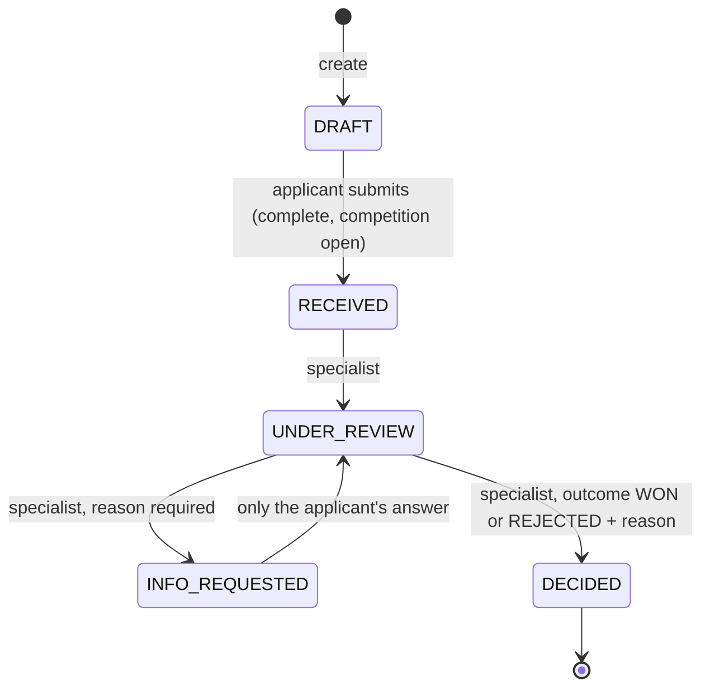

# Data model

The portal's PostgreSQL 16 + PostGIS 3.4 schema, managed with Alembic
(`api/alembic/versions`). The diagram below is **generated from the SQLAlchemy models**
(`api/scripts/er_diagram.py`), so it always matches the code:

```bash
docker compose run --rm --no-deps --entrypoint "" api python scripts/er_diagram.py
```

Codes are ASCII in the database and the API (`RECEIVED`, `CROP`, `AZ-AGM`); Azerbaijani
labels exist only in the user interface. This keeps interfaces such as EKTIS simple and avoids
case-folding problems with `İ`/`ı`.

## The four core objects (PDF §5)

| Object | Table | Key rules |
|---|---|---|
| Entrepreneur (sahibkar) | `entrepreneur` (+ `app_user`) | individual with FİN (7 characters) or company with VÖEN (10 digits), enforced by `ck_entrepreneur_identifier_matches_type`; `is_local` and `origin_rayon_id` for local entrepreneurs; `ektis_farmer_id` when found in the EKTIS registry |
| Farm area (təsərrüfat sahəsi) | `farm_area` | MultiPolygon in EPSG:4326, area in hectares, purpose, conditions of use, lease terms, demining status, distances; code `<RAYON>-NNNN` |
| Competition (müsabiqə) | `competition`, `competition_area` (lots), `competition_required_doc` | maker-checker: `ck_competition_approver_is_not_creator`; number `MS-YYYY-NNN` from `competition_number_seq`; minimum investment per lot |
| Application (müraciət) | `application`, `business_plan`, `application_document`, `status_history`, `info_request` | one per entrepreneur, competition and plot (`uq_application_once`); one winner per plot (`uq_application_one_winner`, partial unique index); number `QIM-YYYY-NNNNNN` from `application_number_seq` at submission; `applicant_snapshot` freezes the applicant data at submission; optimistic locking with `version` |

## Application states



The rules live in one place, `api/app/modules/applications/service.py`. Any other move is
refused with `409 invalid_transition`. A winning decision writes an `integration_outbox`
message for EKTIS in the same transaction.

## Competition states

`DRAFT` → `PENDING_APPROVAL` (specialist submits) → `PUBLISHED` (a supervisor or admin who
is not the creator approves) or back to `DRAFT` with a comment. Publishing re-checks every lot:
cleared of mines, available, not in another open competition.

## Supporting tables

| Table | Purpose |
|---|---|
| `region`, `rayon`, `village` | administrative units and settlements from OpenStreetMap; only curated Azerbaijani names |
| `country_outline`, `water_body` | land outline (map mask) and the Caspian Sea, reloaded on every start |
| `geo_feature` | main roads and water used for suitability distances and offline map tiles |
| `area_suitability` | score, FAO class and factor breakdown per area and activity (method `mcda-1`) |
| `document_type` | reference list of documents, size limits, who must provide them |
| `notification` | in-app notifications for applicants |
| `audit_log` | append-only log of staff actions and personal-data access (`prev_hash`/`hash` reserved for a hash chain) |
| `integration_outbox` | messages for EKTIS waiting for or after delivery (status, attempts, next attempt, EKTIS reference) |
| `integration_log` | every call to EKTIS: operation, HTTP status, duration, X-Request-ID, masked summary |

## Diagram

```mermaid
erDiagram
    APP_USER {
        uuid id PK
        string email UK
        string password_hash
        string full_name
        enum role
        bool is_active
        datetime consent_at
        string consent_version
        int failed_logins
        datetime locked_until
        datetime last_login_at
        datetime created_at
        datetime updated_at
    }
    APPLICATION {
        uuid id PK
        string number UK
        uuid entrepreneur_id FK
        uuid competition_id FK
        uuid farm_area_id FK
        enum activity
        string project_title
        json applicant_snapshot
        enum status
        enum outcome
        text decision_reason
        uuid decided_by FK
        datetime decided_at
        datetime submitted_at
        datetime last_status_at
        int version
        datetime created_at
        datetime updated_at
    }
    APPLICATION_DOCUMENT {
        uuid id PK
        uuid application_id FK
        string doc_type_code FK
        string original_name
        string stored_name UK
        string mime
        int size_bytes
        string sha256
        int version
        bool is_current
        uuid uploaded_by FK
        uuid info_request_id FK
        datetime created_at
    }
    AREA_SUITABILITY {
        uuid farm_area_id PK,FK
        enum activity PK
        string method_version PK
        int score
        enum fao_class
        string constraint_reason
        json factors
    }
    AUDIT_LOG {
        bigint id PK
        uuid actor_id FK
        string actor_role
        string action
        string entity_type
        string entity_id
        json details
        string ip
        datetime created_at
        string prev_hash
        string hash
    }
    BUSINESS_PLAN {
        uuid application_id PK,FK
        decimal investment_azn
        decimal own_funds_pct
        int jobs_planned
        int jobs_local
        int implementation_months
        int experience_years
        text summary
        text products_market
        text technology
        text water_plan
    }
    COMPETITION {
        uuid id PK
        string number UK
        string title_az
        text description_az
        text conditions_az
        datetime opens_at
        datetime deadline_at
        enum status
        uuid created_by FK
        datetime submitted_at
        uuid approved_by FK
        datetime approved_at
        text review_comment
        datetime published_at
        datetime created_at
        datetime updated_at
    }
    COMPETITION_AREA {
        uuid competition_id PK,FK
        uuid farm_area_id PK,FK
        int lot_no
        decimal min_investment_azn
    }
    COMPETITION_REQUIRED_DOC {
        uuid competition_id PK,FK
        string doc_type_code PK,FK
        bool mandatory
    }
    COUNTRY_OUTLINE {
        int id PK
        geometry geom
    }
    DOCUMENT_TYPE {
        string code PK
        string name_az
        text description_az
        string applies_to
        int max_mb
    }
    ENTREPRENEUR {
        uuid id PK
        uuid user_id FK,UK
        enum type
        string fin
        string voen
        string full_name
        string company_name
        string legal_form
        string phone
        string email
        string address
        bool is_local
        int origin_rayon_id FK
        string ektis_farmer_id
        datetime created_at
        datetime updated_at
    }
    FARM_AREA {
        uuid id PK
        string code UK
        string name_az
        int rayon_id FK
        int village_id FK
        geometry geom
        geometry centroid
        decimal area_ha
        enum purpose
        text conditions_of_use
        int lease_term_years
        decimal annual_fee_azn_per_ha
        enum irrigation
        string soil_type
        int dist_water_m
        int dist_road_m
        int dist_village_m
        int elevation_m
        decimal slope_deg
        enum demining_status
        date demining_certified_on
        enum status
        enum data_source
        string ektis_parcel_ref
        uuid created_by FK
        datetime created_at
        datetime updated_at
    }
    GEO_FEATURE {
        int id PK
        string kind
        string subtype
        geometry geom
    }
    INFO_REQUEST {
        uuid id PK
        uuid application_id FK
        uuid requested_by FK
        text message
        json requested_doc_types
        datetime created_at
        datetime responded_at
        text response_text
    }
    INTEGRATION_LOG {
        bigint id PK
        datetime created_at
        string system
        string operation
        string method
        string path
        int status_code
        bool ok
        int duration_ms
        string request_id
        string summary
        string error
        uuid outbox_id FK
        uuid actor_id FK
    }
    INTEGRATION_OUTBOX {
        uuid id PK
        string kind
        uuid application_id FK
        json payload
        enum status
        int attempts
        datetime next_attempt_at
        string last_error
        string ektis_reference
        datetime created_at
        datetime sent_at
    }
    NOTIFICATION {
        uuid id PK
        uuid user_id FK
        string kind
        string title_az
        text body_az
        string link
        uuid application_id FK
        datetime created_at
        datetime read_at
    }
    RAYON {
        int id PK
        int region_id FK
        string iso_code UK
        string short_code UK
        string name_az
        string name_en
        string label_az
        geometry geom
    }
    REGION {
        int id PK
        string code UK
        string name_az
        string name_en
    }
    STATUS_HISTORY {
        bigint id PK
        uuid application_id FK
        enum from_status
        enum to_status
        enum outcome
        uuid actor_id FK
        string actor_role
        text reason
        datetime created_at
    }
    VILLAGE {
        int id PK
        int rayon_id FK
        string name_az
        geometry geom
        bigint osm_id
    }
    WATER_BODY {
        int id PK
        string kind
        geometry geom
    }
    COMPETITION_AREA ||--o{ APPLICATION : "competition_id"
    APP_USER |o--o{ APPLICATION : "decided_by"
    ENTREPRENEUR ||--o{ APPLICATION : "entrepreneur_id"
    COMPETITION_AREA ||--o{ APPLICATION : "farm_area_id"
    APPLICATION ||--o{ APPLICATION_DOCUMENT : "application_id"
    DOCUMENT_TYPE ||--o{ APPLICATION_DOCUMENT : "doc_type_code"
    INFO_REQUEST |o--o{ APPLICATION_DOCUMENT : "info_request_id"
    APP_USER ||--o{ APPLICATION_DOCUMENT : "uploaded_by"
    FARM_AREA ||--o{ AREA_SUITABILITY : "farm_area_id"
    APP_USER |o--o{ AUDIT_LOG : "actor_id"
    APPLICATION ||--o{ BUSINESS_PLAN : "application_id"
    APP_USER |o--o{ COMPETITION : "approved_by"
    APP_USER ||--o{ COMPETITION : "created_by"
    COMPETITION ||--o{ COMPETITION_AREA : "competition_id"
    FARM_AREA ||--o{ COMPETITION_AREA : "farm_area_id"
    COMPETITION ||--o{ COMPETITION_REQUIRED_DOC : "competition_id"
    DOCUMENT_TYPE ||--o{ COMPETITION_REQUIRED_DOC : "doc_type_code"
    RAYON |o--o{ ENTREPRENEUR : "origin_rayon_id"
    APP_USER ||--o{ ENTREPRENEUR : "user_id"
    APP_USER |o--o{ FARM_AREA : "created_by"
    RAYON ||--o{ FARM_AREA : "rayon_id"
    VILLAGE |o--o{ FARM_AREA : "village_id"
    APPLICATION ||--o{ INFO_REQUEST : "application_id"
    APP_USER ||--o{ INFO_REQUEST : "requested_by"
    APP_USER |o--o{ INTEGRATION_LOG : "actor_id"
    INTEGRATION_OUTBOX |o--o{ INTEGRATION_LOG : "outbox_id"
    APPLICATION |o--o{ INTEGRATION_OUTBOX : "application_id"
    APPLICATION |o--o{ NOTIFICATION : "application_id"
    APP_USER ||--o{ NOTIFICATION : "user_id"
    REGION ||--o{ RAYON : "region_id"
    APP_USER |o--o{ STATUS_HISTORY : "actor_id"
    APPLICATION ||--o{ STATUS_HISTORY : "application_id"
    RAYON ||--o{ VILLAGE : "rayon_id"
```


